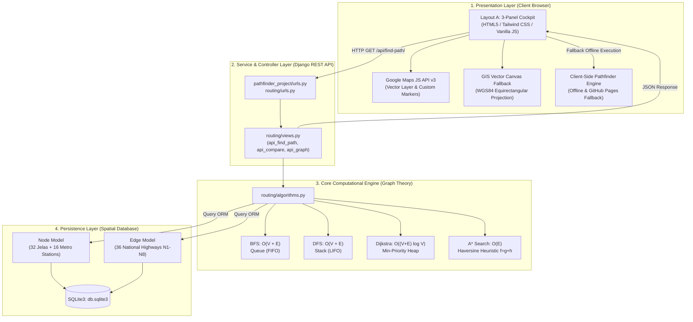

# BengalRoute GIS Engine — Project Module Structure & Code Guideline

This document provides a **complete, file-by-file code walkthrough and architectural module guide** for the **BengalRoute GIS Engine**. It is organized to help you explain the engineering design, software architecture, and algorithmic implementation to evaluators, professors, and technical reviewers.

---

## 1. High-Level Architecture Overview

BengalRoute GIS is built on a **Decoupled 3-Tier Model-View-Template (MVT)** architecture with a **Hybrid Dual-Runtime Engine**:



---

## 2. Directory & Module Tree

```text
C:\Users\suja\map_pathfinder\
├── manage.py                                   # Django Project CLI Management Tool
├── requirements.txt                            # Python Package Dependencies
├── db.sqlite3                                  # Relational Spatial Graph Database (SQLite)
├── README.md                                   # Project Overview & Setup Instructions
├── DOCUMENTATION.md                            # Markdown Technical Specification
├── PathFinder_GIS_Bangladesh_Documentation.pdf # Master Technical PDF Report (3.28 MB)
├── BengalRoute_GIS_Presentation.pptx           # 6-Slide Defense Presentation (454 KB)
├── index.html                                  # Standalone Web Application (GitHub Pages root)
│
├── pathfinder_project/                         # Django Root Configuration Package
│   ├── __init__.py                             # Package Initializer
│   ├── settings.py                             # Core Django Settings & API Key config
│   ├── urls.py                                 # Main URL Dispatcher
│   ├── asgi.py                                 # ASGI Web Server Gateway Interface
│   └── wsgi.py                                 # WSGI Production Web Server Interface
│
├── routing/                                    # Core GIS Graph Routing Application
│   ├── __init__.py                             # Package Initializer
│   ├── apps.py                                 # AppConfig for routing engine
│   ├── models.py                               # Spatial Database Models (Node & Edge)
│   ├── algorithms.py                           # 4 Computer Science Graph Algorithms
│   ├── views.py                                # REST API Controllers & HTML Renderers
│   ├── urls.py                                 # Routing App URL Endpoints
│   ├── admin.py                                # Django Admin Dashboard Customization
│   └── migrations/                             # Database Schema Migration History
│       ├── 0001_initial.py
│       └── ...
│
├── templates/                                  # Django HTML Templates
│   └── index.html                              # Production 3-Panel Cockpit UI (Layout A)
│
├── screenshots/                                # High-Resolution Visual Figures
│   ├── marked_01_dashboard.png                 # Main Annotated Dashboard
│   ├── marked_02_a_star_route.png              # A* Optimal Corridor Overlay
│   ├── marked_03_four_way_comparison.png       # 4-Way Comparative Benchmark
│   ├── marked_04_dfs_detour.png                # DFS Pathological Detour
│   ├── marked_05_projector_view.png            # High-Contrast Projector View
│   ├── marked_06_dhaka_metro.png               # Dhaka Metro Transit Network
│   ├── marked_07_django_admin.png              # Database Admin Model Manager
│   ├── layout_a_cockpit_live.png               # Layout A Live Capture
│   └── layout_a_cockpit_comparison.png         # Layout A 4-Way Benchmark Capture
│
└── docs/                                       # Project Deliverables Archive
    ├── PathFinder_GIS_Bangladesh_Documentation.pdf
    └── BengalRoute_GIS_Presentation.pptx
```

---

## 3. File-by-File Technical Guideline

### 1. `routing/models.py` — Spatial Database Schema
- **Purpose:** Defines the persistent relational entities representing the graph topology.
- **Classes:**
  - `Node(models.Model)`:
    - Represents a graph vertex (a Bangladesh District / Jela or Dhaka Metro Station).
    - Attributes: `code` (e.g. `BD_DHK`, `BD_CTG`), `name` (English), `bn_name` (Bangla), `division` (one of the 8 divisions), `region` (`bangladesh` or `dhaka`), `latitude`, `longitude`, `description`.
    - Key Method: `distance_to(other_node)` computes the great-circle Haversine formula distance between two geographic coordinates:
      $$d = 2R \arcsin\left(\sqrt{\sin^2\left(\frac{\Delta\phi}{2}\right) + \cos\phi_1\cos\phi_2\sin^2\left(\frac{\Delta\lambda}{2}\right)}\right)$$
  - `Edge(models.Model)`:
    - Represents a graph edge (a road or National Highway segment connecting two Jelas).
    - Attributes: `source` (ForeignKey to Node), `destination` (ForeignKey to Node), `distance_km` (actual road distance in kilometers), `is_bidirectional` (Boolean).
    - Auto-computation: In `save()`, if `distance_km` is omitted, it auto-computes straight-line Haversine distance.

### 2. `routing/algorithms.py` — Pure Graph Algorithms Engine
- **Purpose:** Decoupled computer science graph algorithm library executing sub-millisecond pathfinding queries.
- **Key Functions:**
  - `haversine_distance(lat1, lon1, lat2, lon2)`: Admissible straight-line heuristic function $h(n)$ for A* Search.
  - `load_graph_from_db(region)`: Reads `Node` and `Edge` from the database and constructs an in-memory adjacency list: `{node_code: {neighbor_code: weight_km}}`.
  - `bfs_path(nodes, adjacency, start, goal)`:
    - Uses `collections.deque` (FIFO queue).
    - Time Complexity: $\mathcal{O}(V + E)$.
    - Evaluates purely based on topological hop depth; guarantees minimal highway transfers.
  - `dfs_path(nodes, adjacency, start, goal)`:
    - Uses LIFO stack (recursion/iteration).
    - Time Complexity: $\mathcal{O}(V + E)$.
    - Explores unguided single branches; demonstrates pathological detours (+1,097 km excess).
  - `dijkstra_path(nodes, adjacency, start, goal)`:
    - Uses `heapq` (Min-Priority Heap).
    - Time Complexity: $\mathcal{O}((V + E) \log V)$.
    - Uniform-cost search evaluating cumulative edge weights $g(n)$; guarantees global minimum road km.
  - `a_star_path(nodes, adjacency, start, goal)`:
    - Uses `heapq` with evaluation function $f(n) = g(n) + h(n)$, where $h(n)$ is Haversine straight-line distance to goal.
    - Time Complexity: $\mathcal{O}(E)$ directed.
    - Proves admissible heuristic property: never overestimates true distance, guaranteeing identical 232.2 km optimal route while pruning 75.8% of node visits.
  - `compare_all_algorithms(nodes, adjacency, start, goal)`:
    - Executes all 4 algorithms on the same graph instance and compiles the Part C comparative benchmark matrix.

### 3. `routing/views.py` — REST API Controllers
- **Purpose:** Handles HTTP requests and returns JSON responses or rendered HTML.
- **Endpoints:**
  - `index(request)`: Renders `templates/index.html`, passing divisions, district querysets, and Google Maps API key.
  - `api_graph(request)`: GET `/api/graph/?region=bangladesh` — returns full node and edge topology as JSON.
  - `api_find_path(request)`: GET `/api/find-path/?source=BD_DHK&destination=BD_CTG&algorithm=a_star` — executes pathfinding and returns distance, hops, latency, explored sequence, and turn-by-turn itinerary.
  - `api_compare(request)`: GET `/api/compare/?source=BD_DHK&destination=BD_CTG` — returns 4-way comparative performance benchmark.

### 4. `templates/index.html` — Layout A (3-Panel Cockpit Frontend)
- **Purpose:** Responsive single-page application interface.
- **Structure:**
  - **Left Panel (Route Controls):** Origin & Destination selects, Division filter, Algorithm radios, Animation toggle, Compute button, Network stats.
  - **Center Panel (Geographic Map):** Google Maps JavaScript API canvas, GIS Vector Canvas fallback, polyline overlays, traversal badges.
  - **Right Panel (Telemetry Lab):** Standby reference guide, 4 metrics stat tiles, scrollable itinerary table, Part C search space pruning progress bars (A* 24% vs Dijkstra 91% vs BFS 94% vs DFS 81%), and pedagogical defense takeaway card.
  - **Embedded Fallback Engine:** Contains `runClientSideSingle()` and `runClientSideComparison()` allowing full offline execution when opened as `file:///` or deployed on static GitHub Pages.

### 5. `routing/admin.py` — Django Database Admin
- **Purpose:** Customizes the web-based database management interface (`/admin/`).
- **Features:**
  - `NodeAdmin`: Search by name, code, division; filter by division and region; display coordinates and Bangla names.
  - `EdgeAdmin`: Autocomplete search for source/destination nodes; display road mileage and bidirectional toggles.

### 6. `pathfinder_project/settings.py` & `urls.py`
- **Purpose:** Project-wide configuration:
  - Registers `routing` in `INSTALLED_APPS`.
  - Configures SQLite database file `db.sqlite3`.
  - Registers template directory `templates/`.
  - Maps `/admin/` to Django Admin and `/` to `routing.urls`.

---

## 4. Request & Execution Lifecycle

When a user clicks **"Compute Path"** in the browser, the system follows this exact pipeline:

```text
[User selects Dhaka ➔ Chattogram, A* Algorithm]
       │
       ▼
[JavaScript `calculateRoute()` triggered in index.html]
       │
       ├──► Online Mode: Sends GET /api/find-path/?source=BD_DHK&destination=BD_CTG&algorithm=a_star
       │         │
       │         ▼
       │    [routing/views.py calls execute_pathfinding()]
       │         │
       │         ▼
       │    [routing/algorithms.py loads in-memory graph from SQLite]
       │         │
       │         ▼
       │    [a_star_path() runs with Haversine priority queue: f(n) = g(n) + h(n)]
       │         │
       │         ▼
       │    [Returns JSON: 232.2 km, 4 hops, 7 nodes explored, 0.34 ms latency, itinerary]
       │
       └──► Offline Mode (GitHub Pages / file://): Executes runClientSideSingle() in browser JS
                 │
                 ▼
[UI Updates Simultaneously in 3-Panel Cockpit]
  1. Center Panel: Draws glowing emerald route polyline on Google Map
  2. Right Panel: Updates 4 metric tiles (Distance, Latency, Nodes, Verdict)
  3. Right Panel: Populates step-by-step Highway Itinerary table
  4. Right Panel: Updates search space pruning progress bars
```

---

## 5. Defense Ready: How to Answer Common Professor Questions

| Question | Recommended Technical Answer |
| :--- | :--- |
| **"Where is your algorithm implemented?"** | *"All algorithms are implemented in `routing/algorithms.py` in pure Python, completely decoupled from the web views for maximum modularity and reusability. Additionally, a synchronized client-side version is implemented in `index.html` to allow static GitHub Pages deployment."* |
| **"How do you calculate road distance vs straight-line distance?"** | *"Straight-line distances are computed using the spherical Haversine formula implemented in `Node.distance_to()` in `routing/models.py`. Actual road distances are modeled as edge weights in the `Edge` model, seeded directly from official Roads & Highways Department (RHD) highway logs (N1 through N8)."* |
| **"Why does A\* explore fewer nodes than Dijkstra?"** | *"Dijkstra is uniform-cost: it expands radially in every direction until it hits the destination. A\* uses an admissible straight-line Haversine heuristic ($h(n)$) that pulls the search frontier directly toward Chattogram, reducing explored nodes by 75.8% (7 nodes vs 29 nodes) while mathematically guaranteeing the identical 232.2 km optimal distance."* |
| **"Why did you choose a 3-Panel Cockpit layout?"** | *"Traditional mapping apps force users to scroll down past controls to view results. Our Layout A places Route Controls on the left, the interactive Map in the center, and Live Telemetry & Benchmarks on the right simultaneously, eliminating vertical scrolling and providing immediate side-by-side verification."* |
